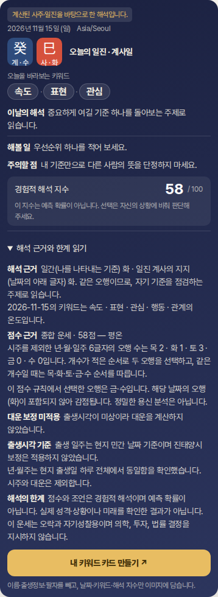
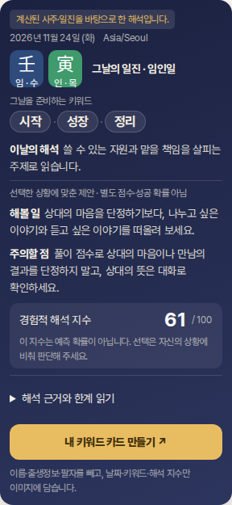

# 기본 풀이 평가 전 점검

`103cea0`에서 발견한 출생시각 미상 안내의 불일치를 고치고, 문구 비교와 UI 탐색을 분리한 평가 자료를 준비했다. 아직 사람 평가는 시작하지 않았다. 참가 의사 확인은 1명, 받은 응답은 0건이며 최소 4명 추가 모집이 필요하다. 자료·채점표 확정 전 첫 응답도 받지 않는다.

이 문서와 함께 제공하는 PR #2의 전체 head 커밋을 새 검토 후보로 사용한다. 이전 `103cea0`은 수정 전 기준이며, 첫 세션 전에 승인된 전체 SHA와 자료 해시를 기록해야 한다. 코드나 문구가 달라진 응답을 같은 버전으로 합치지 않는다.

## 계산 범위와 안내 수정

시각 미상일 때 “출생 일·시주는 현지 민간시 기준”이라고 안내하면서 다음 줄에 시주를 제외했다고 쓰던 모순을 없앴다. 실제 시주가 비었고 날짜 전체 검증 또는 절기 경계 미확정 메타데이터가 확인되는 경우에만 미상 분기로 처리한다. 출생시각이 있는 경우와 성별만 누락된 경우의 대운 부재를 시각 미상 때문이라고 추측하지 않는다.

- 일주 안내: “출생 일주는 현지 민간 날짜 기준이며 진태양시 보정은 적용하지 않았습니다.” 민간시와 미보정 메타데이터를 실제로 확인한 경우에만 표시한다.
- 대운 안내: “출생시각이 미상이라 대운을 계산하지 않았습니다.” 그 외 미적용 사유가 확인되지 않으면 기존 일반 안내를 유지한다.
- 오행 안내: “시주를 제외한 년·월·일주 6글자의 오행 수는 …”으로 계산 범위를 함께 표시한다. 오행 합계와 확정 간지의 글자 수가 일치하는지 확인하며 숫자 6을 임의로 넣지 않는다.

웹의 기본 풀이, 프로필 팔자 요약, 브리지의 경고, 한국어 채널의 대운 사유, 영어의 동일한 일·시주/대운 안내를 함께 고쳤다. 점수·등급·간지·오행 집계·대운 계산·API 스키마는 변경하지 않았다. 이번에는 안내 문구를 의도적으로 바꿨으므로 “103cea0과 모든 출력이 같다”고 보고하지 않는다.

## 직접 실행한 검증

[별도 프로세스 비교 결과](basic-reading-time-scope.json)는 공개 `103cea0`을 임시 디렉터리에 추출하고 두 버전의 실제 Node 브리지와 Python 코드를 각각 실행한 결과다. 모든 프로필은 가상 성인 입력이다.

| 입력 조건 | 계산 기둥 | 오행 집계 글자 수 | 대운 | 일일 풀이 |
| --- | --- | ---: | --- | --- |
| 시각 입력, 성별 입력 | 년·월·일·시 | 8 | 계산 | 제공 |
| 시각 미상, 일반 날짜·서울 | 년·월·일 | 6 | 미계산 | 제공 |
| 시각 미상, 일반 날짜·뉴욕 | 년·월·일 | 6 | 미계산 | 제공 |
| 시각 미상, 입춘 경계일 | 일 | 2 | 미계산 | 거부 |
| 시각 미상, 절입 경계일 | 년·일 | 4 | 미계산 | 거부 |

- 차트 5건의 계산 필드와 일일 풀이 제공/거부 결과가 같다.
- 일일 풀이 300건의 계산 필드·해석·행동·주의·한계는 같다. 시각 미상 150건의 계산 범위 안내만 바뀌었다.
- 한국어·영어 채널 문자열 600건 중 각각 150건의 미상 안내가 바뀌었다. 시각 입력 사례는 문구까지 같다.
- 오늘·내일·주간·D-day API 18건의 계산 필드는 같다. 미상 사례의 한국어·영어 일일 본문과 D-day 본문 7건이 바뀌며 주간 본문은 같다.
- 공개 main 대비 기존 표시 외 필드 300건 비교와 가상 샘플 재생성도 통과했다.
- Fortune 전체 78개 파일: **1,642 passed, 3 failed, 14 skipped in 55.56s**. `103cea0` 대비 새 14개 검사가 통과했고 실패 집합은 기존과 같다. 전체 통과로 처리하지 않는다.

기존 실패는 `test_fortune_oracle_combined_english.py`의 실제 4체계 계산·CLI 근거 검사 2건과 `test_fortune_oracle_routing_evidence.py::test_astrology_calculation_sources_survive_adapter_and_renderer`다. 건너뜀을 통과에 포함하지 않는다.

## 화면 확인

[최종 브라우저 기록](basic-reading-evaluation-browser.json)은 Chromium 156 모바일 viewport 모사다. 레이아웃 **90개**, 표시 **16개**, 문맥 **1개**, 상태 **10개**가 통과했다. 320·360·390·412·430px에서 가로 넘침·잘림·페이지 오류·외부 요청은 없었다. 접힌 높이는 **475–625px**, 390px 펼친 높이는 **960–1,045px**다. 소스 9개의 검사 전후 해시가 같다.

초기 안내를 두 문장으로 붙였을 때 B의 2026-11-16 시험 사례가 1,066px로 높이 기준을 넘었다. 계산 범위 안내를 오행 수 문장에 합쳐 중복 표현을 줄인 뒤 전체 범위를 다시 검사했다. CSS·본문 크기·줄 간격을 바꾸거나 내용을 잘라내지 않았다.





날짜·상황 변경 후 이전 응답을 버리는 처리는 기존 구현 검사와 이번 동일 검사 스크립트 재실행에서 확인됐다. 공유·클라이언트 상태의 별도 스크립트 전체나 기존 범용 브라우저 127행 실패는 이번 안내 수정에서 재실행하지 않았다. 과거 결과와 이번 결과를 합쳐 전체 브라우저 통과로 보고하지 않는다.

## 평가 자료와 기록

- [운영안·배정표·사례별 채점표·집계 규칙](basic-reading-evaluation-operator.md)
- [운영자용 버전·해시 대응표](evaluation/operator-manifest.json)
- [참가자 안내](evaluation/participant/instructions.md), [개별 응답지](evaluation/participant/response-sheet.md), [비교 응답지](evaluation/participant/comparison-sheet.md), [UI·범위 관찰지](evaluation/participant/observation-sheet.md)
- 참가자 읽기 자료 a~d는 운영자가 배정표에 따라 한 편씩 제시한다. 정답과 버전 대응표는 참가자에게 주지 않는다.

문구 비교를 마친 뒤 UI 과제로 넘어간다. UI는 가상 A·2026-11-24·만남 상황의 실제 후보 화면을 사용한다. [접힌 캡처](evaluation/participant/ui-collapsed.png)를 먼저 보여주고, 참가자가 상세 확인을 원하면 [펼친 캡처](evaluation/participant/ui-expanded.png)를 보여주는 보조 방식도 준비했다. 캡처로 수행하면 클릭·실제 웹 스크롤은 측정 불가이며 실제 기기 검증으로 집계하지 않는다. 실제 웹을 사용할 경우 임시 미리보기에 동일한 가상 입력을 넣고 창 크기·장치·브라우저·사용 커밋을 기록한다. 날짜가 허용 범위를 벗어났다면 임의로 다른 날짜를 대체하지 말고 자료를 다시 고정한다.

통과율의 분모는 **배정 인원**이며 응답자 수로 축소하지 않는다. 행동 재진술은 2점만 성공으로 센다. 1-Y의 행동 없음은 NA, 2-X의 “고민을 말로 꺼내기”는 실제 원문에 있는 행동으로 구분한다. 질문 후 무응답과 질문 전 미실시도 구별한다. 사례별 필요한 유효 응답 5명 전에는 판정을 보류한다.

## 재현

저장소의 Python·Node 의존성과 Playwright/Chromium이 필요하다. 샘플과 비교 자료를 생성한 다음, 새 임시 미리보기에서 브라우저 검사를 실행한다.

```bash
.venv/bin/python scripts/build_basic_reading_review.py
.venv/bin/python scripts/check_basic_reading_time_scope.py
.venv/bin/python scripts/run_fortune_tests.py $(rg --files tests plugins/tests | rg '/test_(fortune_oracle.*|daily_fortune_engine)\.py$')
.venv/bin/python web/preview.py --port 8892
```

별도 터미널에서 실행한다.

```bash
.venv/bin/python scripts/check_fortune_web_basic_reading_browser.py --url http://127.0.0.1:8892 --output /tmp/fortune-evaluation-final
cp /tmp/fortune-evaluation-final/basic-reading-browser.json docs/reviews/basic-reading-evaluation-browser.json
cp /tmp/fortune-evaluation-final/ui-meeting-390-collapsed.png docs/reviews/evaluation/participant/ui-collapsed.png
cp /tmp/fortune-evaluation-final/ui-meeting-390-expanded.png docs/reviews/evaluation/participant/ui-expanded.png
.venv/bin/python scripts/build_basic_reading_evaluation.py
```

생성기는 소스와 샘플·브라우저 기록의 해시를 대조하며 참가자 자료 9개, 캡처 2개, 운영자 전용 manifest를 만든다. 재생성이나 커밋만으로 자료 확정이 이뤄지지는 않는다. 세션 CSV에 승인된 전체 후보 SHA·자료 묶음 해시·절차 revision·실제 제시 순서를 기록해야 한다.

실제 기기·Safari·화면 낭독기·글자 확대·PDF·사람의 읽기 유용성은 미검증이다. 절기 경계에서 “잠시 후 다시 시도”라고 하는 기존 오류 안내, 시간대 영문 표기, 키워드 반복, D-day 해석과 상황 조언의 연결은 후속 확인으로 남긴다. 병합·배포·판매 검증은 수행하지 않았다.
