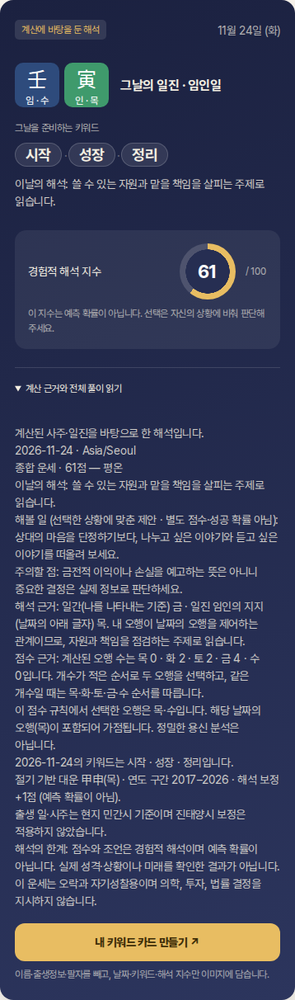
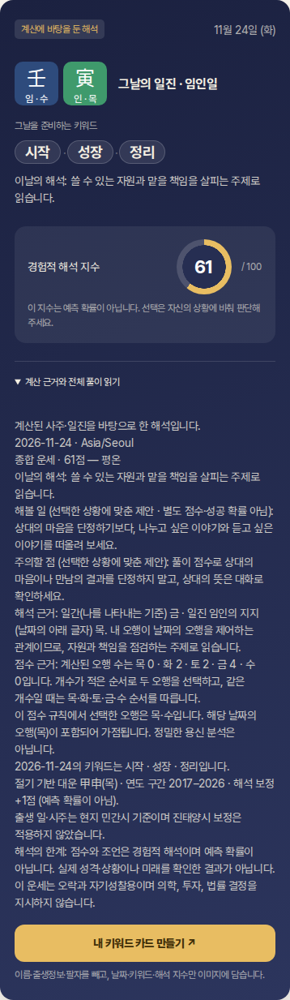
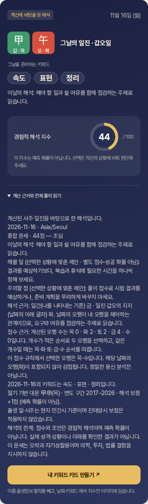

# 기본 풀이 모바일 검토

> 이 문서는 UI 변경 전 `6b892e5`의 기록입니다. 후속 구조화 UI의 실제 노출·높이 측정은 [기본 풀이 UI 검토](basic-reading-ui.md)를 확인하세요. 아래 JSON의 `actionVisibleWhenCollapsed: false`는 당시 검사 코드에 고정한 값이었으며 독립적인 측정값이 아닙니다. 후속 검사에서는 실제 DOM 표시 상태와 viewport 안 위치를 각각 측정합니다.

2026-11-15, 공개 저장소 기준 커밋 `2f10b1ee25127f8930082b5b8afd9e34b7603eac`에 이 PR의 엔진·웹 변경을 적용한 상태에서 재검사했다. **자동 레이아웃·표시 내용·D-day 상태 검사는 통과했고, 문단 구성은 보완이 필요하다.** 실제 휴대전화와 PDF 검증은 수행하지 않았다.

## 확인 범위와 재현

로컬 임시 DB를 사용하는 `web/preview.py`, Chromium `156.0.8078.4`의 모바일 viewport 에뮬레이션을 사용했다. 가상 성인 입력은 [전후 샘플](basic-reading-samples.md)과 같다. A는 1990-05-15 07:30, 남성, 서울 시간대이며 B는 1988-03-02, 시간·성별 미입력, 서울 시간대다. 웹의 오늘 풀이 날짜는 실행일인 **2026-11-15**이며 내일·D-day에서는 11월 16~18일과 24일도 확인했다. 전후 기본 풀이 텍스트 샘플의 고정 날짜와는 다르다. 실제 고객 자료, 자유문장 고민 입력, 외부 모델은 사용하지 않았다. 검사 후 두 임시 프로필을 삭제했다.

설치된 Python·Node 기본 웹 의존성과 Playwright/Chromium이 필요하다. 저장소 루트에서 별도 터미널로 실행한다.

```bash
.venv/bin/python web/preview.py --port 8877
.venv/bin/python scripts/check_fortune_web_basic_reading_browser.py \
  --url http://127.0.0.1:8877 --output /tmp/fortune-basic-reading-review
```

검사 스크립트는 `/healthz`의 `local-preview` 버전을 확인하고 브라우저의 외부 요청을 차단한다. 기존 운영 서버를 검사 대상으로 사용하지 않는다.

## 자동 검사 결과

2개 프로필 × 3개 너비(320·390·430px) × 접힘/펼침 = **12개 상태**를 확인했다. 높이는 모두 844px다. 가로 페이지 넘침, 전체 풀이의 텍스트 가로 잘림, 브라우저 JavaScript 오류, 외부 요청은 발견되지 않았다. 이 검사는 문장 내용의 적절함이나 모든 형태의 겹침을 자동으로 판정하지 않는다.

| 너비 | A 펼친 카드 높이 | B 펼친 카드 높이 | 화면 높이 대비 |
| --- | ---: | ---: | ---: |
| 320px | 1,297px | 1,318px | 1.54–1.56배 |
| 390px | 1,191px | 1,212px | 1.41–1.44배 |
| 430px | 1,059px | 1,101px | 1.25–1.30배 |

전체 풀이 영역은 A 704자, B 715자이며 글자 크기 14px, 줄 높이 21px였다. 중복 면책 제거 후의 수치다. 카드 높이만 측정했으므로 페이지 전체 이동량이나 읽는 데 걸리는 시간으로 해석하지 않는다. 접힌 카드에는 쉬운 해석이 보이지만 행동 제안과 주의점은 펼쳐야 보인다.

[측정·표시 내용·상태 검사 기록](basic-reading-browser.json)을 함께 제공한다. JSON의 `fullTextHeight`는 접힌 상태에서도 브라우저가 계산한 레이아웃 높이를 반환할 수 있으므로 펼친 상태의 수치만 가시 영역 평가에 사용한다. 스크립트는 레이아웃 12개와 D-day 2개의 캡처를 생성한다. 저장소에는 현재 결과의 대표 4개와 문맥 문제를 재현한 수정 전 캡처 1개를 포함했다.

레이아웃과 별도로 실제 API 응답과 화면을 대조한 **16개 표시 내용 검사**를 다시 실행했다. 오늘·내일·D-day의 general/exam/meeting 및 날짜 전환을 포함한다. 모든 상태에서 기본 해석은 접힌 카드에 표시되고, 펼친 본문에는 행동과 주의가 각각 한 개, 전체 면책 문단이 한 번 나타났다. general은 기본 행동·주의를 유지하며 exam/meeting은 두 항목을 함께 선택한 상황에 맞춘 제안으로 대체한다. 시험·만남별로 정한 주의 문구와 화면의 문장을 정확히 비교하고, 원래 행동·주의나 별도 성찰 질문을 덧붙이지 않는지도 검사했다. 이 횟수는 전환 후 재확인을 포함한 검사 수이며 사용자 평가 인원수가 아니다.

**6개 상태 검사**도 통과했다. 두 프로필에서 D-day 폼을 편집할 때 오늘 결과가 유지되고, D-day 결과를 보고 있는 상태에서 날짜·상황을 바꾸면 이전 결과와 공유 상태가 사라짐을 확인했다. A에서는 서버 응답을 의도적으로 보류한 뒤 날짜 또는 상황을 바꿔, 취소된 이전 응답이 돌아와도 결과를 복원하지 못하고 새 입력으로 다시 제출할 수 있음을 확인했다. 수정 전에는 선택은 exam인데 general 응답이 표시되는 문제가 재현됐다.

직전 `05460a0` 변경의 연관 회귀에서는 `check_fortune_web_growth_browser.py`의 공유·D-day·삭제 흐름 **15항목**, `check_fortune_web_client_state_browser.py`의 프로필 저장·삭제·다른 보기·타임아웃 복구 **13항목**이 통과했다. 두 스크립트에서 JavaScript 오류와 외부 요청은 없었다. client-state의 첫 실행은 같은 서버에서 앞선 검사 요청이 누적되어 예상 400 대신 요청 제한 429를 받아 중단됐다. 새 임시 서버에서 단독 재실행한 결과가 13항목 통과다. 이번 행동·주의 문맥 수정에서는 위 12개 레이아웃·16개 표시 내용·6개 상태와 아래 문맥 사례를 재실행했으며, growth/client-state나 범용 브라우저 스크립트 전체를 다시 실행하지는 않았다.

## 만남 상황과 wealth 해석의 문맥 회귀

가상 A, 날짜 **2026-11-24**, 상황 **meeting**, 계산 관계 **wealth**로 문제를 재현했다. 수정 전 커밋 `05460a0`에서는 행동은 상대와 나눌 이야기를 떠올리라고 안내하면서, 주의는 “금전적 이익이나 손실을 예고하는 뜻은 아니니 중요한 결정은 실제 정보로 판단하세요.”라고 표시했다. 다음은 동일한 입력·날짜·상황으로 실제 브라우저에서 얻은 전후 화면이다.





수정 후 주의는 “풀이 점수로 상대의 마음이나 만남의 결과를 단정하지 말고, 상대의 뜻은 대화로 확인하세요.”다. 기본 해석과 계산 관계는 유지되며, 행동과 주의 두 항목에 선택한 상황에 맞춘 제안임을 표시한다. [같은 날짜의 general/exam/meeting 전후 본문](basic-reading-dday.md)도 함께 볼 수 있다.

이 사례는 기존 16개와 별개인 **문맥 검사 1개**로 `contextObservations`에 기록했다. 자동 재현에서는 앞으로 12일의 실제 API 결과에서 첫 wealth 날짜를 찾고(이번 실행은 10개 날짜 조회), 폼에서 그 날짜와 meeting을 선택해 화면을 열었다. 만남 행동과 만남 주의가 각각 한 번 표시되고 기존 금전 주의가 본문에 없는 것을 확인했다. 이 좁은 문맥 검사를 모든 상황 문구의 품질 합격으로 해석하지 않는다.

## 캡처 검토와 문단 제안

위 전후 캡처와 아래 세 캡처를 직접 확인했다. 명백한 텍스트 겹침·잘림이나 한글이 빈 사각형으로 표시되는 현상은 보이지 않았다. 이는 해당 Chromium 환경과 다섯 캡처에 대한 확인이며, 모든 OS의 글꼴 대체 동작이나 전체 글리프 범위를 검증한 결과는 아니다.




현재 `index.html`은 전체 풀이를 단일 `p#full-text`에 넣고, `app.js`는 `result.text`를 `textContent`로 삽입한다. `white-space: pre-line` 덕분에 엔진의 줄바꿈은 보존되지만, 소제목을 나타내는 HTML 요소나 문단 간 간격은 없다. 엔진이 해석·행동·주의·근거를 순서대로 나눠도 화면에서는 연속된 긴 글로 보인다. 소제목을 훑어보거나 보조기기로 항목을 찾아가기 어려운 상태다.

다음 UI 검토에서는 구조화된 항목으로 해석·행동·주의·근거·한계를 전달하고 각 항목을 제목과 문단으로 표시할 것을 제안한다. 접기 앞에는 쉬운 해석과 작은 행동 한 가지를 두고, 펼친 뒤에는 자세한 근거를 두는 배치를 비교한다. 기존 문장의 특정 접두사를 분석해 항목을 추측하기보다 데이터 구조로 구분하는 편이 안정적이다. 이 PR에서는 웹 구조를 바꾸지 않았다.

## 미검증 사항

- 실제 iOS/Android 기기, Safari, 시스템 글자 크기 확대, 화면 낭독기, 사람의 읽기 속도와 스크롤 부담은 미검증이다.
- 현재 공개 저장소에서 PDF 생성·내보내기 기능과 PDF 잘림·겹침 검사 경로를 찾지 못했다. 전달받은 PDF도 없어 PDF 재검사를 실행하지 못했다. 웹 캡처를 PDF 합격 근거로 사용하지 않는다.
- 기본 풀이의 유용성, 개인적으로 느껴지는 정도, 해석 근거의 납득도는 사용자 평가가 필요하다. 자동 검사와 캡처 검토만으로 콘텐츠 품질을 통과 처리하지 않는다.
