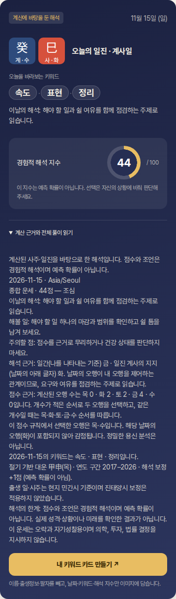
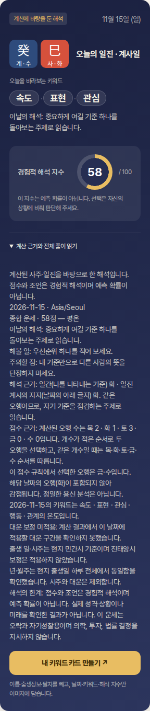

# 기본 풀이 모바일 검토

2026-11-15, 공개 저장소 기준 커밋 `2f10b1ee25127f8930082b5b8afd9e34b7603eac`에 이 PR의 엔진 문구 변경을 적용한 상태에서 확인했다. **자동 레이아웃 검사는 통과했고, 문단 구성은 보완이 필요하다.** 실제 휴대전화와 PDF 검증은 수행하지 않았다.

## 확인 범위와 재현

로컬 임시 DB를 사용하는 `web/preview.py`, Chromium `156.0.8078.4`의 모바일 viewport 에뮬레이션을 사용했다. 가상 성인 입력은 [전후 샘플](basic-reading-samples.md)과 같다. A는 1990-05-15 07:30, 남성, 서울 시간대이며 B는 1988-03-02, 시간·성별 미입력, 서울 시간대다. 웹의 풀이 날짜는 실행일인 **2026-11-15**이고, 전후 텍스트 샘플의 고정 날짜와는 다르다. 실제 고객 자료, 고민 입력, 외부 모델은 사용하지 않았다. 검사 후 두 임시 프로필을 삭제했다.

설치된 Python·Node 기본 웹 의존성과 Playwright/Chromium이 필요하다. 저장소 루트에서 별도 터미널로 실행한다.

```bash
.venv/bin/python web/preview.py --port 8877
.venv/bin/python scripts/check_fortune_web_basic_reading_browser.py \
  --url http://127.0.0.1:8877 --output /tmp/fortune-basic-reading-review
```

검사 스크립트는 `/healthz`의 `local-preview` 버전을 확인하고 브라우저의 외부 요청을 차단한다. 기존 운영 서버를 검사 대상으로 사용하지 않는다.

## 자동 검사 결과

2개 프로필 × 3개 너비(320·390·430px) × 접힘/펼침 = **12개 상태**를 확인했다. 높이는 모두 844px다. 가로 페이지 넘침, 전체 풀이의 텍스트 가로 잘림, 브라우저 JavaScript 오류, 외부 요청은 발견되지 않았다. 이 검사는 문장 내용의 적절함이나 모든 형태의 겹침을 자동으로 판정하지 않는다.

| 너비 | A 펼친 카드 높이 | B 펼친 카드 높이 | 화면 높이 대비 |
| --- | ---: | ---: | ---: |
| 320px | 1,339px | 1,360px | 1.59–1.61배 |
| 390px | 1,212px | 1,233px | 1.44–1.46배 |
| 430px | 1,080px | 1,122px | 1.28–1.33배 |

전체 풀이 영역은 A 734자, B 745자이며 글자 크기 14px, 줄 높이 21px였다. 카드 높이만 측정했으므로 페이지 전체 이동량이나 읽는 데 걸리는 시간으로 해석하지 않는다. 접힌 카드에는 쉬운 해석이 보이지만 행동 제안과 주의점은 펼쳐야 보인다.

[12개 상태의 측정 기록](basic-reading-browser.json)을 함께 제공한다. JSON의 `fullTextHeight`는 접힌 상태에서도 브라우저가 계산한 레이아웃 높이를 반환할 수 있으므로 펼친 상태의 수치만 가시 영역 평가에 사용한다. 스크립트는 12개 캡처를 생성하며, 저장소에는 아래 대표 2개만 포함했다.

## 캡처 검토와 문단 제안

아래 두 캡처를 직접 확인했다. 명백한 텍스트 겹침·잘림이나 한글이 빈 사각형으로 표시되는 현상은 보이지 않았다. 이는 해당 Chromium 환경과 두 캡처에 대한 확인이며, 모든 OS의 글꼴 대체 동작이나 전체 글리프 범위를 검증한 결과는 아니다.





현재 `index.html`은 전체 풀이를 단일 `p#full-text`에 넣고, `app.js`는 `result.text`를 `textContent`로 삽입한다. `white-space: pre-line` 덕분에 엔진의 줄바꿈은 보존되지만, 소제목을 나타내는 HTML 요소나 문단 간 간격은 없다. 엔진이 해석·행동·주의·근거를 순서대로 나눠도 화면에서는 연속된 긴 글로 보인다. 소제목을 훑어보거나 보조기기로 항목을 찾아가기 어려운 상태다.

다음 UI 검토에서는 구조화된 항목으로 해석·행동·주의·근거·한계를 전달하고 각 항목을 제목과 문단으로 표시할 것을 제안한다. 접기 앞에는 쉬운 해석과 작은 행동 한 가지를 두고, 펼친 뒤에는 자세한 근거를 두는 배치를 비교한다. 기존 문장의 특정 접두사를 분석해 항목을 추측하기보다 데이터 구조로 구분하는 편이 안정적이다. 이 PR에서는 웹 구조를 바꾸지 않았다.

## 미검증 사항

- 실제 iOS/Android 기기, Safari, 시스템 글자 크기 확대, 화면 낭독기, 사람의 읽기 속도와 스크롤 부담은 미검증이다.
- 현재 공개 저장소에서 PDF 생성·내보내기 기능과 PDF 잘림·겹침 검사 경로를 찾지 못했다. 전달받은 PDF도 없어 PDF 재검사를 실행하지 못했다. 웹 캡처를 PDF 합격 근거로 사용하지 않는다.
- 기본 풀이의 유용성, 개인적으로 느껴지는 정도, 해석 근거의 납득도는 사용자 평가가 필요하다. 자동 검사와 캡처 검토만으로 콘텐츠 품질을 통과 처리하지 않는다.
