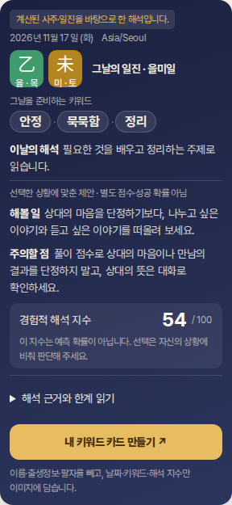
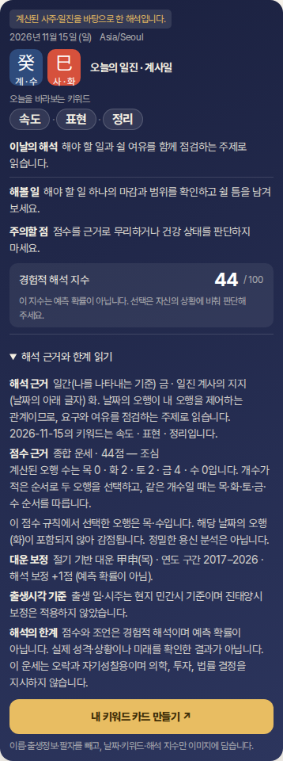
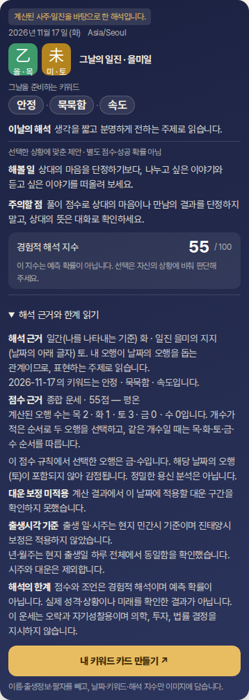

# 기본 풀이 모바일 UI 후속 검토

기준 커밋은 `6b892e5`이며 작업 브랜치는 `fortune-oracle-basic-reading-ui`다. 기본 풀이의 해석·행동·주의를 접힌 카드에서 읽고, 펼친 뒤에는 항목별 근거를 읽도록 바꿨다. 문장을 잘라내거나 작은 글자로 숨기지 않고 기존 본문을 구조화해 표시한다.

## 표시 구조와 호환성

카드는 날짜·풀이 시간대, 키워드, 해석, 행동, 주의, 해석 지수, 근거 펼치기 순서다. `sections.theme/action/caution`을 각각 제목과 본문으로 표시하며 `reading.lines[1]`에서 해석을 추측하지 않는다. D-day에서는 행동과 주의에 공통으로 붙는 출처 문구를 한 번 표시한다. 긴 qualifier가 짧은 qualifier 뒤에 ` · `로 이어지는 같은 출처 문구일 때 긴 원문을 그대로 사용한다.

펼친 근거는 관계·점수·대운·출생시각 기준(있을 때)·한계로 나뉜다. 각 그룹은 `section > h4 + p` 구조이며 제목은 본문 앞에 굵게 배치했다. 해석·행동·주의를 상세에 다시 넣지 않는다. 모든 출력은 `textContent` 또는 생성한 텍스트 노드를 사용한다.

`sections`는 schema version, 필수 항목, 문자열 타입, 근거 그룹 ID·중복 여부를 검증한다. 없거나 형식이 잘못된 응답에서는 구조화한 항목을 모두 지우고 기존 `result.text`를 전체 풀이에 표시한다. 정상 sections를 표시할 때 `#full-text`에 전체 원문을 숨겨 두지 않고 비운다. 날짜·상황 전환, 오류, 프로필 삭제 시 새 필드도 함께 지워 이전 결과가 남지 않도록 했다.

주요 DOM은 다음과 같다.

| 내용 | DOM |
| --- | --- |
| 해석 | `#daily-theme-title`, `#day-relation` |
| 행동 | `#daily-action-title`, `#daily-action` |
| 주의 | `#daily-caution-title`, `#daily-caution` |
| 행동·주의의 공통 출처 | `#daily-practice-qualifiers` |
| 풀이 시간대 | `#reading-timezone` |
| 근거·한계 | `#daily-evidence > section[data-evidence]` |
| 구형·형식 오류 응답의 전체 원문 | `#full-text` |

## 모바일 실측

2026-11-15에 로컬 임시 미리보기와 Chromium `156.0.8078.4`를 사용했다. 가상 A는 1990-05-15 07:30, 남성, 서울 시간대이고 가상 B는 1988-03-02, 시간·성별 미입력, 서울 시간대다. 두 프로필의 오늘 풀이, 2026-11-16의 일반·시험 상황, 11월 17일의 만남 상황, A의 11월 24일 wealth 관계·만남 상황을 확인했다. 실제 고객 정보와 외부 모델은 사용하지 않았다.

최종 CSS에서 직접 실측한 범위는 위 9개 결과 × 5개 너비(320·360·390·412·430px) × 접힘/펼침 = 90개 상태다. viewport 높이는 844px다. 카드 상단을 화면 상단에 맞춰 행동과 주의 본문의 경계도 확인했다.

| 실측 항목 | 결과 | 기준 |
| --- | ---: | ---: |
| 접힌 카드 높이 | 475–625px | 844px 이하 |
| 390px 펼친 카드 높이 | 960–1,045px | 1,050px 이하 |
| 접힌 상태의 주의 본문 하단 | 최대 364px | 844px 안에 표시 |
| 근거 소제목 | 5개 | 4개 이상 |
| 가로 넘침 | 없음 | 없음 |

주요 본문과 소제목은 14px이며 여러 줄 본문은 1.5배 줄 간격을 유지한다. 출처·시간대 등 보조 정보는 12px다. 카드 상단과 지수 영역의 여백을 줄였으며 공유 카드, 월간·통합 결과의 레이아웃은 변경하지 않았다.

[최종 자동 검사 기록](basic-reading-ui-browser.json)에서도 같은 높이 기준을 통과했다. 레이아웃 90개(오늘 20개·D-day 70개), 표시 내용 16개, meeting/wealth 문맥 사례 1개, 상태 검사 10개를 확인했다. 상태 검사에는 기존 날짜·상황 전환 6개와 sections가 없는 구형 응답·부분 누락·중복 근거·잘못된 버전의 fallback 4개가 포함된다. JavaScript 오류와 외부 요청은 없었으며, 검사 전후 소스 SHA가 같아 실행 도중 코드가 바뀌지 않았음을 확인했다.

[연관 화면 흐름 검사](basic-reading-ui-flow-checks.json)는 공유·D-day·삭제 15항목과 클라이언트 상태·복구 13항목이 통과했다. 이 두 검사는 마지막 CSS 여백 조정 전에 실행했으며, 그 뒤에는 높이에 영향을 받는 위 90개 레이아웃 검사를 다시 실행했다. [기존 결과 호환성 기록](basic-reading-ui-compatibility.json)은 계산값과 기존 본문·채널 출력을 비교한 별도 결과다. 이 자동 검증을 실제 사용자의 읽기 평가로 대신하지 않는다.

아래 대표 캡처를 직접 확인했다. 이 화면들에서는 명백한 글자 겹침·잘림이나 한글 누락이 보이지 않았다.







## 엔진·API·채널 검증

기존 관련 178개와 새 sections 계약 16개를 함께 실행해 **194 passed in 13.48s**를 확인했다. Fortune 관련 전체 77개 파일은 **1,628 passed, 3 failed, 14 skipped in 55.02s**다. 실패 목록은 앞선 공개 main 검증에서 재현한 다음 세 건과 같으며 전체 통과로 처리하지 않는다.

- `test_fortune_oracle_combined_english.py::test_actual_english_four_method_calculation_and_provenance`
- `test_fortune_oracle_combined_english.py::test_cli_combined_english_has_real_evidence`
- `test_fortune_oracle_routing_evidence.py::test_astrology_calculation_sources_survive_adapter_and_renderer`

`build_basic_reading_review.py`는 `6b892e5`의 엔진·일일 출력·웹 서비스를 별도로 불러와 비교한다. 새 표시 필드 `sections`만 제외하면 기존 반환값 **300건**, 한국어·영어 채널 문자열 **600건**, 오늘·내일·주간·D-day API 응답 **18건**이 같다. 이 비교는 `lines`, `disclaimer`, `text`까지 포함한다. 별도로 공개 main 대비 300건의 표시 외 필드 비교도 유지했다. 주간 응답 내부의 한국어 reading에도 sections가 추가되지만 주간 text는 그대로이며, 영어에는 한국어 sections를 넣지 않는다.

전체 테스트와 비교 자료는 다음 명령으로 재실행할 수 있다. 테스트 실행기는 임시 저장소를 사용하고 외부 전송을 차단한다.

```bash
.venv/bin/python scripts/run_fortune_tests.py $(rg --files tests plugins/tests | rg '/test_(fortune_oracle.*|daily_fortune_engine)\.py$')
.venv/bin/python scripts/build_basic_reading_review.py
```

기존 범용 브라우저 검사 127행 실패는 이번 UI 작업에서 다시 검사하거나 해결하지 않았다. 위 기록은 실행한 세 브라우저 스크립트의 범위에 한정한다.

## 재현과 미검증 범위

기본 Python·Node 웹 의존성과 Playwright/Chromium을 설치한 뒤 저장소 루트에서 로컬 임시 미리보기를 실행한다.

```bash
.venv/bin/python web/preview.py --port 8877
.venv/bin/python scripts/check_fortune_web_basic_reading_browser.py \
  --url http://127.0.0.1:8877 --output /tmp/fortune-basic-reading-ui
```

HTML 템플릿을 수정했다면 미리보기를 다시 시작해 스크립트와 같은 버전으로 검사한다. 여러 브라우저 검사를 한 임시 서버에 연속 실행하면 요청 제한에 걸릴 수 있으므로 검사별 환경을 분리한다.

실제 iOS/Android 기기, Safari, 화면 낭독기, 시스템 글자 크기 확대, PDF, 사용자 대상 읽기 평가는 아직 수행하지 않았다. 위 수치는 명시한 가상 사례의 브라우저 실측이며 모든 날짜·프로필·번역문에서의 최대 길이를 보장하지 않는다. 콘텐츠의 유용성이나 예측 타당성에 대한 합격 판정도 아니다.
